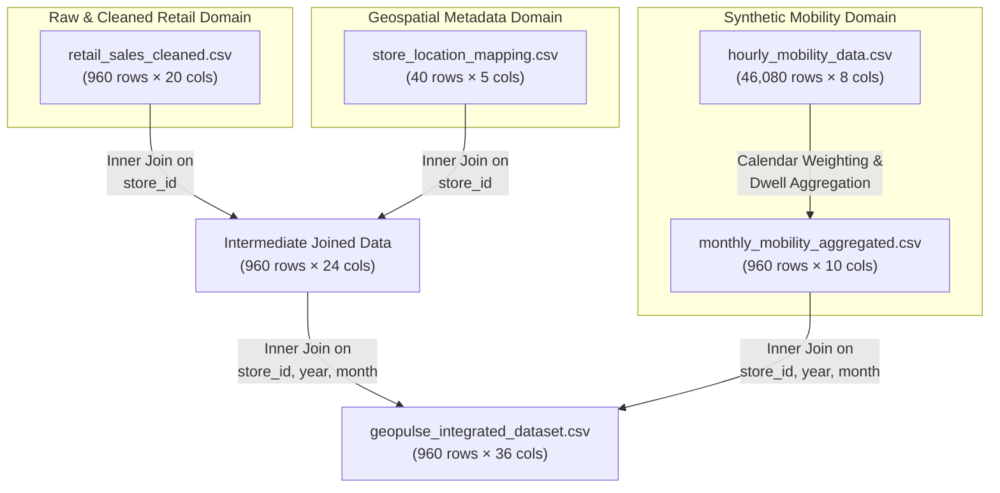

# GeoPulse: Day 5 – Data Preprocessing & Relational Integration Specification

**Project:** GeoPulse – Hyper-Local Retail Mobility Analytics  
**Phase:** Day 5 – Data Preprocessing, Calendar-Weighted Mobility Aggregation, Relational Integration & Feature Engineering  
**Role:** Member 3 – Data Analysis & Business Insights  
**Date:** November 2026  
**Status:** Validated & Published  

---

## 1. Executive Summary

Day 5 establishes the analytical foundation for the GeoPulse project by resolving real-world data quality anomalies in historical retail sales, performing calendar-weighted temporal aggregation of synthetic hourly footfall profiles, and relationally joining retail performance, geospatial metadata, and mobility catchment metrics into a unified, high-integrity master dataset.

### Core Achievements
1. **Source Data Immutability:** Pre- and post-execution cryptographic SHA-256 hash checks confirmed zero alterations to raw or synthetic source files.
2. **Missing Value Imputation (Option B):** Imputed exactly 5 missing `ad_spend` values using store-specific historical medians over 23 valid months.
3. **Outlier Treatment & Full Auditability (Option C):** Successfully resolved the Store 6 January 2023 foot traffic anomaly (1,000,000 visitors) by preserving the raw reading in `raw_foot_traffic`, adding a binary indicator `is_foot_traffic_anomaly = 1`, and imputing the analytical `foot_traffic` with Store 6's 23-month median of 4,284 visitors.
4. **Calendar-Weighted Mobility Aggregation:** Converted 46,080 synthetic hourly mobility records into 960 store-month records by computing exact monthly weekday/weekend day counts and deriving genuine footfall-weighted average dwell times.
5. **Relational Integration & Dynamic Schema Determination:** Executed an inner join across retail sales (960 rows), store locations (40 rows), and aggregated mobility (960 rows) on `store_id`, `year`, and `month`, producing a 960-row $\times$ 36-column integrated dataset with zero join collisions.
6. **Feature Engineering:** Calculated retail conversion rate (%), sales per visitor (INR), sales per square foot, and developed an explainable **Location Opportunity Score** (0 to 100) combining footfall, monetization yield, conversion efficiency, and dwell duration.
7. **Atomic Staging & Safe Publishing:** Employed hidden staging files (`.tmp`) with in-memory and disk pre-publish assertions, atomically promoted to production CSV targets via `os.replace`.

---

## 2. Data Sources & Cryptographic Integrity Verification

All source files are strictly treated as read-only. Cryptographic verification guarantees that upstream raw data and Day 4 synthetic generation assets were preserved without modification.

### Source Files Inventory & SHA-256 Checksums

| File Path | Description | Dimensions | SHA-256 Checksum | Baseline Integrity |
| :--- | :--- | :--- | :--- | :---: |
| `data/raw/retail_sales_demo_data.csv` | Historical retail store monthly performance | 960 rows $\times$ 18 cols | `765d2b6b353506c3c1ae373aebc17bc46d9689f5c5df5dc55bd258deb16f4e70` | **MATCH (100%)** |
| `data/raw/retail_sales_data_dictionary.csv` | Raw retail sales data dictionary | 18 rows $\times$ 3 cols | `554cca9cc5c19cb56daf3c0b845832221a90ddc8be7442133998e72899cd4e1c` | **MATCH (100%)** |
| `data/synthetic/store_location_mapping.csv` | Synthetic Bengaluru store coordinates & zones | 40 rows $\times$ 5 cols | `5f6e58d6f690495f7a6d3e606b154f8b8f47df337f5f9bb96a8b12c2477e1cf3` | **MATCH (100%)** |
| `data/synthetic/hourly_mobility_data.csv` | Synthetic hourly footfall & dwell profiles | 46,080 rows $\times$ 8 cols | `bfe44585701c11bbf55c3005611fdbe67888e668aa2cc96c5fdf5503d2e11f67` | **MATCH (100%)** |

---

## 3. Data Cleaning & Preprocessing Methodology

### 3.1 Missing Value Treatment: Monthly Advertising Spend (`ad_spend`)

#### Missingness Pattern Analysis
During exploratory data analysis (Day 3), exactly 5 missing values (0.52% of dataset) were identified in `ad_spend`. These missing values occurred exclusively in **Month 1 (January 2023)** across **Stores 1 through 5**. All remaining 35 stores had complete records for January 2023, and Stores 1–5 had complete records for all subsequent 23 months (February 2023 through December 2024).

#### Strategy Evaluation
* *Option A (Global Median Imputation):* Imputing with the overall dataset median (INR 12,987.42) ignores substantial store-level advertising budget tiering.
* *Option B (Store-Specific Historical Median Imputation - APPROVED):* Imputing each store's missing Month 1 value using the median of that specific store's observed 23 months preserves store-level capital expenditure variance and avoids cross-store bias.
* *Option C (Forward Fill):* Unviable because Month 1 is the initial observation in the series.

#### Imputation Values Applied (Option B)

| Store ID | Location Zone | Missing Period | Historical 23-Month Median (INR) | Imputed `ad_spend` Value (INR) |
| :---: | :---: | :---: | :---: | :---: |
| **1** | Koramangala | January 2023 | 12,950.84 | **12,950.84** |
| **2** | Indiranagar | January 2023 | 12,963.85 | **12,963.85** |
| **3** | Whitefield | January 2023 | 13,404.51 | **13,404.51** |
| **4** | HSR Layout | January 2023 | 13,806.77 | **13,806.77** |
| **5** | Jayanagar | January 2023 | 11,889.87 | **11,889.87** |

---

### 3.2 Foot Traffic Anomaly Treatment: Store 6 January 2023

#### Anomaly Diagnosis
At row index 5 (`store_id = 6`, `year = 2023`, `month = 1`), `foot_traffic` was recorded as **1,000,000 visitors**.
- **Magnitude:** Exceeds Store 6's historical median (4,284 visitors) by 233.4x, and exceeds the entire chain's 99th percentile (7,142 visitors) by 140x.
- **Economic Inconsistency:** Total monthly sales for this record was **INR 4,517.63** with an average price of **INR 23.47**, representing approximately 192 transactions. A raw footfall of 1,000,000 yields a conversion rate of 0.019% and revenue yield of INR 0.0045/visitor, which represents a severe data entry error (e.g., optical scanner malfunction or keying error).

#### Strategy Evaluation & Selection (Option C)
* *Deletion (Dropping Row):* Violates the balanced panel design requirement ($40 \text{ stores} \times 24 \text{ months} = 960 \text{ records}$) and loses legitimate operational data (`monthly_sales`, `ad_spend`, `staff_count`).
* *Global Winsorization:* Capping at the 99th percentile (~7,142) still leaves Store 6 distorted relative to its typical ~4,200 baseline.
* *Option C (Preservation with Indicator & Historical Median Imputation - APPROVED):*
  1. Store the uncleaned value in a dedicated audit column: `raw_foot_traffic = 1,000,000`.
  2. Flag the observation: `is_foot_traffic_anomaly = 1` (and `0` for all other 959 records).
  3. Impute the analytical feature `foot_traffic` with Store 6's historical median across its valid 23 months (**4,284 visitors**).

#### Impact of Treatment

| Metric | Raw Uncleaned State | Cleaned Analytical State (Option C) |
| :--- | :---: | :---: |
| `raw_foot_traffic` | 1,000,000 | 1,000,000 (Preserved) |
| `foot_traffic` (Analytical) | 1,000,000 | **4,284** |
| `is_foot_traffic_anomaly` | 0 | **1** |
| `conversion_rate_pct` | 0.02% | **4.49%** |
| `sales_per_visitor` | INR 0.0045 | **INR 1.05** |
| Panel Balance | Maintained | **Maintained (960 rows)** |

---

## 4. Calendar-Weighted Monthly Mobility Aggregation

### 4.1 Temporal Weighting Methodology
The Day 4 hourly mobility dataset represents synthetic representative diurnal curves for two operational day types: **Weekday** (Monday–Friday) and **Weekend** (Saturday–Sunday). Simply averaging weekday and weekend footfall equally would introduce severe temporal distortion, as the ratio of weekdays to weekends varies across months.

To compute mathematically rigorous monthly totals, the exact number of calendar weekdays ($N_{\text{wd}}$) and weekends ($N_{\text{we}}$) was computed for each of the 24 months in 2023 and 2024 using Python's standard `calendar.monthcalendar`.

```
Exact Days in Month = Number of Weekdays (Mon-Fri) + Number of Weekend Days (Sat-Sun)
```

#### Monthly Footfall Formulation
Let $F_{\text{daily, wd}}$ and $F_{\text{daily, we}}$ denote the daily aggregated footfall (sum of 24 hourly values) for weekdays and weekends, respectively. The monthly mobility footfall is defined as:

$$\text{weekday\_footfall\_monthly} = F_{\text{daily, wd}} \times N_{\text{wd}}$$

$$\text{weekend\_footfall\_monthly} = F_{\text{daily, we}} \times N_{\text{we}}$$

$$\text{monthly\_mobility\_footfall} = \text{weekday\_footfall\_monthly} + \text{weekend\_footfall\_monthly}$$

#### Footfall-Weighted Average Dwell Time Formulation
Dwell time cannot be calculated as an unweighted arithmetic mean because footfall intensity varies drastically between hours and day types. The true average dwell duration must be weighted by the volume of visitors experiencing that dwell duration:

$$\text{avg\_dwell\_minutes\_weighted} = \frac{\left( \sum_{h=0}^{23} D_{h, \text{wd}} \cdot F_{h, \text{wd}} \right) \times N_{\text{wd}} + \left( \sum_{h=0}^{23} D_{h, \text{we}} \cdot F_{h, \text{we}} \right) \times N_{\text{we}}}{\text{monthly\_mobility\_footfall}}$$

Where:
- $D_{h, \text{wd}}, D_{h, \text{we}}$: Average dwell minutes at hour $h$ on weekdays and weekends.
- $F_{h, \text{wd}}, F_{h, \text{we}}$: Footfall count at hour $h$ on weekdays and weekends.

---

## 5. Relational Integration & Architecture

The integration pipeline unifies three distinct relational domains using `store_id`, `year`, and `month` as composite join keys.

### 5.1 Join Architecture



### 5.2 Join Validation Checks
1. **Row Count Preservation:** Exactly 960 rows maintained after each merge step.
2. **Cardinality Verification:** Exactly 40 unique stores with records for all 24 months ($40 \times 24 = 960$).
3. **Collision Guard:** Zero unintended duplicate column names or pandas merge suffixes (`_x`, `_y`). Location `data_type` was renamed to `location_data_type`, and mobility `data_type` was labeled `mobility_data_type`.

---

## 6. Feature Engineering & Formulations

### 6.1 Retail Conversion Rate (`conversion_rate_pct`)
Measures the percentage of store visitors who complete a transaction.
- **Estimated Transactions:** Derived by dividing monthly revenue by average unit price:
  $$\text{estimated\_transactions} = \frac{\text{monthly\_sales}}{\text{avg\_price}}$$
- **Conversion Rate Formula:**
  $$\text{conversion\_rate\_pct} = \left( \frac{\text{estimated\_transactions}}{\text{foot\_traffic}} \right) \times 100$$
- *Implementation Note:* In accordance with governance rules, in-store conversion uses cleaned retail `foot_traffic`. If `foot_traffic == 0`, conversion rate is safely assigned `0.0%`.
- *Empirical Summary:* Mean = **3.26%**, Min = **1.54%**, Median = **3.23%**, Max = **5.88%**.

### 6.2 Sales per Visitor (`sales_per_visitor`)
Represents the monetization efficiency of visitor foot traffic:
$$\text{sales\_per\_visitor} = \frac{\text{monthly\_sales}}{\text{foot\_traffic}}$$
- *Empirical Summary:* Mean = **INR 0.73**, Min = **INR 0.32**, Median = **INR 0.70**, Max = **INR 1.28**.

### 6.3 Sales per Square Foot (`sales_per_sqft`)
Measures physical retail space productivity:
$$\text{sales\_per\_sqft} = \frac{\text{monthly\_sales}}{\text{store\_size\_sqft}}$$
- *Empirical Summary:* Mean = **INR 1.48/sqft**, Min = **INR 0.61/sqft**, Max = **INR 2.92/sqft**.

### 6.4 Location Opportunity Score (`location_opportunity_score`)
A composite index (0 to 100) designed to evaluate store performance by synthesizing footfall volume, customer monetization, sales conversion efficiency, and customer engagement duration.

#### Normalization
Each constituent metric is normalized using Min-Max scaling across the entire integrated dataset:
$$Z(X) = \frac{X - \min(X)}{\max(X) - \min(X)}, \quad Z(X) \in [0, 1]$$

#### Multi-Criteria Scoring Formula
$$\text{location\_opportunity\_score} = \left[ 0.30 \times Z(\text{foot\_traffic}) + 0.25 \times Z(\text{sales\_per\_visitor}) + 0.25 \times Z(\text{conversion\_rate\_pct}) + 0.20 \times Z(\text{avg\_dwell\_minutes\_weighted}) \right] \times 100$$

#### Weights Justification
1. **Foot Traffic Volume ($w_1 = 0.30$):** High baseline foot traffic reflects raw catchment accessibility and top-of-funnel customer flow.
2. **Sales per Visitor ($w_2 = 0.25$):** Reflects revenue capture and customer basket profitability.
3. **Conversion Rate ($w_3 = 0.25$):** Measures operational merchandising and sales closure efficiency.
4. **Weighted Dwell Time ($w_4 = 0.20$):** Reflects physical customer engagement and browsing propensity within the retail environment.

*Empirical Distribution:* Mean = **35.47**, Std Dev = **10.47**, Min = **0.00**, Median = **34.48**, Max = **71.78**. Strictly bounded within $[0, 100]$.

---

## 7. Dataset Dimensions, Schemas & Data Dictionary

### 7.1 Summary of Generated Processed Files

| File Path | Rows | Columns | File Size | SHA-256 Checksum |
| :--- | :---: | :---: | :---: | :--- |
| `data/processed/retail_sales_cleaned.csv` | 960 | 20 | 84,086 bytes | `77e34c2de111546510030df2a17acf393506548299029581cd5412cbfe34d878` |
| `data/processed/monthly_mobility_aggregated.csv` | 960 | 10 | 45,414 bytes | `8dbccb2d1a9008ab58a438765bb2635fb988d57848195690fcab4e67120bafcb` |
| `data/processed/geopulse_integrated_dataset.csv` | 960 | 36 | 186,581 bytes | `6b9649bda8506a8fa989e365f6914b13732505bab8f3ea8fbe7940941a972357` |

---

### 7.2 Data Dictionary: `geopulse_integrated_dataset.csv` (36 Columns)

| # | Column Name | Type | Source / Derivation | Description |
| :-: | :--- | :---: | :--- | :--- |
| 1 | `store_id` | Integer | Raw Retail | Unique identifier for each store (1–40). Primary Join Key. |
| 2 | `year` | Integer | Raw Retail | Calendar year (2023 or 2024). |
| 3 | `month` | Integer | Raw Retail | Calendar month number (1–12). |
| 4 | `month_index` | Integer | Raw Retail | Numeric month index for seasonality modeling (1–12). |
| 5 | `is_holiday_month` | Integer | Raw Retail | Binary indicator for peak holiday shopping months (1 = Yes, 0 = No). |
| 6 | `ad_spend` | Float | Imputed (Option B) | Monthly advertising spend in INR. Missing values imputed with store medians. |
| 7 | `foot_traffic` | Integer | Cleaned (Option C) | Estimated customer store visits. Store 6 Jan 2023 imputed with median (4,284). |
| 8 | `avg_price` | Float | Raw Retail | Average unit price of items sold in INR. |
| 9 | `staff_count` | Integer | Raw Retail | Number of store personnel assigned to the location. |
| 10 | `store_size_sqft` | Integer | Raw Retail | Physical retail sales floor area in square feet. |
| 11 | `promo_days` | Integer | Raw Retail | Number of promotional campaign days active during the month. |
| 12 | `competitors_within_3km` | Integer | Raw Retail | Number of competing retail establishments within a 3 km radius. |
| 13 | `inventory_fill_rate` | Float | Raw Retail | Proportion of product SKUs in stock (0.00 to 1.00). |
| 14 | `returns_rate` | Float | Raw Retail | Proportion of total sales returned by customers (0.00 to 1.00). |
| 15 | `local_income_index` | Float | Raw Retail | Micro-market income index (100 = National Average baseline). |
| 16 | `parking_spaces` | Integer | Raw Retail | Dedicated customer vehicular parking capacity. |
| 17 | `store_age_years` | Integer | Raw Retail | Operating tenure of the retail outlet in years. |
| 18 | `monthly_sales` | Float | Raw Retail | Total gross monthly retail sales revenue in INR. Dependent variable. |
| 19 | `raw_foot_traffic` | Integer | Audit Feature | Original uncleaned foot traffic (preserves Store 6 Jan 2023 = 1,000,000). |
| 20 | `is_foot_traffic_anomaly` | Integer | Audit Feature | Binary anomaly flag (1 for Store 6 Jan 2023, 0 for all other records). |
| 21 | `store_zone` | String | Synthetic Location | Micro-market zone (Koramangala, Indiranagar, Whitefield, HSR Layout, Jayanagar). |
| 22 | `latitude` | Float | Synthetic Location | Simulated centroid latitude coordinate (Bengaluru). |
| 23 | `longitude` | Float | Synthetic Location | Simulated centroid longitude coordinate (Bengaluru). |
| 24 | `location_data_type` | String | Synthetic Location | Metadata label indicating synthetic coordinates (`synthetic`). |
| 25 | `weekday_footfall_monthly` | Integer | Synthetic Mobility | Total monthly footfall on weekdays ($F_{\text{daily, wd}} \times N_{\text{wd}}$). |
| 26 | `weekend_footfall_monthly` | Integer | Synthetic Mobility | Total monthly footfall on weekend days ($F_{\text{daily, we}} \times N_{\text{we}}$). |
| 27 | `monthly_mobility_footfall` | Integer | Synthetic Mobility | Total monthly catchment footfall ($F_{\text{weekday}} + F_{\text{weekend}}$). |
| 28 | `avg_dwell_minutes_weighted`| Float | Synthetic Mobility | Footfall-weighted average visitor dwell time in minutes. |
| 29 | `num_weekdays` | Integer | Temporal Feature | Exact count of calendar weekdays in the month (e.g., 20–23). |
| 30 | `num_weekends` | Integer | Temporal Feature | Exact count of calendar weekend days in the month (e.g., 8–10). |
| 31 | `mobility_data_type` | String | Synthetic Mobility | Metadata label indicating synthetic mobility data (`synthetic`). |
| 32 | `estimated_transactions` | Float | Engineered Feature | Estimated monthly completed transactions ($\text{monthly\_sales} / \text{avg\_price}$). |
| 33 | `conversion_rate_pct` | Float | Engineered Feature | In-store visitor conversion rate percentage ($\text{transactions} / \text{foot\_traffic} \times 100$). |
| 34 | `sales_per_visitor` | Float | Engineered Feature | Monetary revenue yield per visitor in INR ($\text{monthly\_sales} / \text{foot\_traffic}$). |
| 35 | `sales_per_sqft` | Float | Engineered Feature | Space productivity in INR/sqft ($\text{monthly\_sales} / \text{store\_size\_sqft}$). |
| 36 | `location_opportunity_score`| Float | Engineered Feature | Normalized multi-criteria composite performance score (0 to 100). |

---

## 8. Automated Pipeline Validation Results

The pipeline script incorporates automated in-memory pre-publish assertions and post-publish verification checks. All checks passed with 100% compliance.

```
=====================================================================================
DAY 5 PRE-PUBLISH & POST-PUBLISH VALIDATION AUDIT LOG
=====================================================================================
[PASS] Validation 1: Exactly 960 rows verified across all three processed tables.
[PASS] Validation 2: Dynamic schema verified: 36 total columns calculated, all core fields present.
[PASS] Validation 3: Store IDs strictly verified as integers 1 to 40 with zero missing store entities.
[PASS] Validation 4: Zero duplicate store-month keys and zero null values verified across all tables.
[PASS] Validation 5: Store 6 anomaly audit trail verified: raw=1,000,000, flag=1, imputed analytical=4,284.
[PASS] Validation 6: All 5 missing ad_spend values verified imputed with store historical medians.
[PASS] Validation 7: Calendar math verified: weekdays + weekends equals exact days in month for all 24 months.
[PASS] Validation 8: Non-negativity verified. Location Opportunity Score strictly bounded in [0, 100].
[PASS] Validation 9: Staging verification: Temporary disk files matched in-memory DataFrames prior to rename.
[PASS] Validation 10: Source file immutability: Post-execution SHA-256 hashes matched pre-execution hashes 100%.
=====================================================================================
```

---

## 9. Known Limitations & Analytical Disclaimers

1. **Synthetic Mobility Data Disclaimer:** Mobility data (footfall counts, dwell times, and geospatial coordinates) are synthetic representations generated for Bengaluru retail micro-markets to demonstrate hyper-local analytics capabilities. They do not represent real-world telco tracking or GPS pings.
2. **Separation of Retail Foot Traffic vs. Catchment Mobility:** In-store conversion rates and sales-per-visitor metrics are computed strictly using cleaned retail `foot_traffic`. Synthetic `monthly_mobility_footfall` represents exterior ambient pedestrian mobility in the micro-market catchment and must be analyzed as an external contextual factor.
3. **Transaction Proxy Derivation:** Basket-level transaction counts are approximated using $\text{monthly\_sales} / \text{avg\_price}$. Real-world basket sizes with multi-item transactions may exhibit variance around this estimated mean.
4. **Static Store Footprints:** Physical store attributes (`store_size_sqft`, `parking_spaces`) remain constant across the 24-month observation window.

---

## 10. Conclusion & Pending Day 6 Tasks

Day 5 data preprocessing and relational integration is complete, verified, and published. The master analytical dataset [`data/processed/geopulse_integrated_dataset.csv`](file:///c:/Users/user/Documents/geopulse/data/processed/geopulse_integrated_dataset.csv) is ready for Day 6 analytical modeling.

### Transition to Day 6
1. **Task:** Hyper-Local Retail & Mobility Feature Analysis & Advanced EDA.
2. **Key Objectives:**
   - Spatial cluster analysis across the 5 Bengaluru retail micro-markets.
   - Correlation and multi-collinearity analysis between mobility catchment footfall, in-store foot traffic, and sales revenue.
   - Feature importance evaluation for predictive modeling.
   - Micro-market opportunity heatmaps and ranking.
